  

# 🏢 Awesome Visitor Tracking & Reception Management 📋

  
  
  
  
  

> 🚀 A curated list of top **Visitor Tracking and Reception Management** software — comparing enterprise SaaS platforms with starting pricing and free tier limits alongside production-ready open-source alternatives for front-desk digital check-in, host notifications, badge printing, and visitor logging.

🌟 **Star this repo if you find it useful!** 🌟

---

## 📑 Table of Contents

- [📈 Sector Overview & Market Dynamics](#-sector-overview--market-dynamics)
- [🟦 SaaS / Hosted Platforms](#-saas--hosted-platforms)
- [🟩 Open-Source Software](#-open-source-software)
- [🔍 Key Feature Comparison](#-key-feature-comparison)
- [⭐ Star History](#-star-history)
- [💖 Support](#-support)
- [🤝 Contributing](#-contributing)
- [📄 License](#-license)

---

## 📈 Sector Overview & Market Dynamics

The global **Visitor Management System (VMS)** market is currently valued at approximately **$2.1B to $2.4B** and is projected to expand to **$4.0B–$6.5B+ by the early 2030s** at a compound annual growth rate (CAGR) of **~12%–14%**. The market is **moderately fragmented**: while large industrial conglomerates (Honeywell, HID Global, Johnson Controls) and well-funded workplace unicorns (Envoy) lead multi-site enterprise deployments, the lower barrier to entry for cloud SaaS and specialized compliance requirements (such as healthcare, schools, and regional privacy mandates) foster a healthy and competitive long tail of agile mid-market providers.

---

## 🟦 SaaS / Hosted Platforms

🏢 Commercial, cloud-hosted Visitor Tracking and Reception Management platforms. Sorted by company scale (market cap / valuation / revenue) in descending order.

| 🏢 Platform | 💰 Company Valuation / Revenue | 🏷️ Starting Price | 🎁 Free Tier / Free Trial Limits | ⚡ Key Strengths & Target Use Case |
|---|---|---|---|---|
| **[Sine (Honeywell)](https://www.sine.co/)** | **~$146.9B** Market Cap / $38.5B Rev (Honeywell HON) | **$69 / month** (Sine Core entry) | **30-day free trial**; no permanent free tier | 🏭 Industrial, logistics, construction, contractor induction, and enterprise health/safety compliance. |
| **[Proxyclick (Eptura)](https://www.eptura.com/products/visitor/)** | **~$50M–$100M+** Private (backed by Thoma Bravo / Eptura) | **$100 / month** (or custom site quote) | **15-day free trial** upon sales request; no permanent free tier | 🌐 Enterprise multi-site access governance, deep physical access control (PACS), and global compliance. |
| **[Envoy Visitors](https://envoy.com/products/visitors/)** | **$1.4B** Valuation (Series C Unicorn) / ~$90M ARR | **$109 / month per location** (Standard tier) | **Permanent Free Tier:** Up to **100 visitor entries/month**, host notifications & employee sign-in (no badge printing/NDAs); **14-day free trial** on paid tiers | 📱 Polished iPad check-in, badge printing, workplace scheduling, NDA signing, and enterprise integrations. |
| **[iLobby (FacilityOS)](https://ilobby.com/)** | **$100M+** Funding (Insight Partners) / ~$25M+ Rev | **$199 / location / month** (VisitorOS) | **Sales demo sandbox trial on request**; no permanent free tier | 🛡️ Turnkey hardware + software kiosk deployments with contractor compliance, screening, and asset monitoring. |
| **[Traction Guest (Sign In Enterprise)](https://tractionguest.com/)** | Acquired by **PSG / ShieldCo** / Enterprise multi-million ARR | **$275 / device / month** (Salesforce AppExchange starting tier) | **Enterprise trial / sandbox on request**; no permanent free tier | 🔒 High-security enterprise visitor screening, custom watchlist checks, NDAs, and audit workflows. |
| **[SwipedOn](https://www.swipedon.com/)** | **~$10.5M** Rev (SmartSpace Software / Sign In App group) | **$49 / month** (billed annually) | **14-day free trial** (full access without credit card); no permanent free tier | 📋 Intuitive tablet check-in, badge printing, emergency roll-call rosters, and quick QR sign-ins. |
| **[The Receptionist for iPad](https://thereceptionist.com/)** | Part of **Sign In App ecosystem** / Bootstrapped SMB leader | **$52.50 / month** ($630/site/year billed annually) | **15-day free trial** (unlimited features without credit card); no permanent free tier | 🔔 Dedicated iPad kiosk experience with two-way SMS communication, badge printing, and contactless scan. |
| **[Greetly](https://www.greetly.com/)** | Bootstrapped / Acquired SMB portfolio (~$1M+ Rev) | **$99 / month** (Essential tier billed annually) | **14-day free trial** (no credit card required); no permanent free tier | 🎨 100% white-labeled touchless reception, voice check-in, delivery logging, and visitor routing. |

---

## 🟩 Open-Source Software

💻 Self-hosted, community-driven Visitor Tracking and Reception Management software and templates. Sorted by GitHub star count in descending order.

| 📦 Project | ⭐ Stars | 🛠️ Stack | 📜 License | 💡 Description & Best For |
|---|---|---|---|---|
| **[heyform/heyform](https://github.com/heyform/heyform)** |  | Node.js / React / Mongo | Open Source | 📝 Open-source form builder widely integrated with n8n/PostgreSQL to create customizable front-desk check-in portals with automated host email/Slack/SMS dispatch. |
| **[neozhu/visitormanagement](https://github.com/neozhu/visitormanagement)** |  | C# / .NET / SQL Server | Open Source | 🏛️ Full digital check-in to replace paper registers with entry/exit tracking, visitor history logs, and security guard oversight for corporate or university campuses. |
| **[AmitXShukla/Visitor-Management-App](https://github.com/AmitXShukla/Visitor-Management-App)** |  | Angular 13 / Node / Express / MongoDB | MIT | 📸 Electronic visitor register app for managing host and guest records with photo capture, clean responsive UI, and visit records. |
| **[sanjeev662/visitor-management-system-react](https://github.com/sanjeev662/visitor-management-system-react)** |  | React / Node.js | MIT | 👥 Modern visitor management dashboard with role-based access control for administrators, receptionists, and gate guards. |
| **[COS301-SE-2022/Intelligent-VMS](https://github.com/COS301-SE-2022/Intelligent-VMS-Visitor-Management-System-)** |  | TypeScript / Python / React | MIT | 🤖 Intelligent residential and commercial visitor management system featuring invitation links, contractor permits, and AI visiting analytics. |
| **[shubhamkumar27/Django-Visitor-Management-System](https://github.com/shubhamkumar27/Django-Visitor-Management-System)** |  | Python / Django / SQLite | Open Source | 🐍 Lightweight Django web portal for tracking campus visitor logs, host meetings, check-ins, and departures. |
| **[md-sazzadul-islam/front-desk-visitor-management](https://github.com/md-sazzadul-islam/front-desk-visitor-management)** |  | PHP / Laravel / MySQL | MIT | 🛎️ Front-desk reception management application designed to handle visitor registrations, guest check-in receipts, and visitor statistics. |
| **[rohan-takmoge/Gate-Pass-management-System](https://github.com/rohan-takmoge/Gate-Pass-management-System)** |  | PHP / MySQL | MIT | 🚪 Gate pass and visitor management portal providing pass generation, entry/exit logging, and verification for offices and industrial facilities. |
| **[iamKunal/Visitor-Management-Sys](https://github.com/iamKunal/Visitor-Management-Sys)** |  | Python / Django | MIT | 🏫 Automated campus security tracking system for laborers, technicians, and guests moving across perimeter gates. |
| **[ParshwaS/VMS](https://github.com/ParshwaS/VMS)** |  | Python / Django / Bootstrap | MIT | 🔍 Clean visitor logging software featuring host notification triggers, visitor entry badging, and search filters. |
| **[P0etInc0de/VisitorPortal](https://github.com/P0etInc0de/VisitorPortal)** |  | PHP / Laravel | Open Source | 🎫 Open-source Laravel visitor management portal with visit pre-registration, reception check-in/out, PDF badges, welcome displays, and RBAC. |
| **[Codefor-Future/people-registry](https://github.com/Codefor-Future/people-registry)** |  | JavaScript / Node.js | MIT | 📲 Contactless QR-code visitor register allowing guests to self-check-in on mobile devices without physical paperwork. |
| **[trohit/visify](https://github.com/trohit/visify)** |  | PHP / Python / MySQL | Open Source | 🖨️ Lightweight visitor tracking utility supporting ESC/POS thermal badge printing, photo capture, multi-gate logs, and gate pass generation. |
| **[IamMuuo/karibu](https://github.com/IamMuuo/karibu)** |  | Go / Charm Bubbletea | MIT | 💻 Interactive terminal guestlog application for developer events, hackathons, and tech conferences over SSH. |
| **[mishravk79/visitorinout](https://github.com/mishravk79/visitorinout)** |  | PHP / MySQL / Koha | MIT | 📚 Dr. Ranganathan release visitor log tailored specifically for library attendance, member tracking, and entry statistics. |

---

## 🔍 Key Feature Comparison

| ⚙️ Feature | 🏢 Enterprise SaaS (Envoy, Honeywell Sine, iLobby) | 📱 SMB SaaS (SwipedOn, The Receptionist, Greetly) | 💻 Self-Hosted Open-Source (VMS, Laravel, Django) |
|---|---|---|---|
| **🚀 Deployment** | Multi-tenant Cloud / Hybrid | Cloud / App Store (iPad / Android) | Docker, Bare Metal, On-Premises |
| **🎁 Free Tier Available** | Rare (Envoy has 100 entries/mo plan) | 14–15 Day Free Trials | 100% Free & Open Source |
| **🖨️ Badge Printing** | Wireless Brother/Zebra AirPrint & RFID | Bluetooth / AirPrint Thermal Badges | ESC/POS Thermal & Printable PDF |
| **📱 Hardware Required** | Enrolled iPads / Kiosk Stands / Gate Access | Off-the-shelf iPad or Tablet | Any browser, tablet, or terminal |
| **🛡️ Compliance & NDA** | Watchlist screening, ITAR, HIPAA, GDPR | Digital signatures, basic NDAs | Custom database storage |
| **🔔 Host Notifications** | Slack, Microsoft Teams, SMS, Webhooks | SMS, Email, Push Notifications | Email / Custom Webhook triggers |

---

## 📈 Star History

---

## 💖 Support

Thank you for visiting and using **Awesome Visitor Tracking & Reception Management**! 🌟

If you found this resource valuable, please consider supporting the project:
- ⭐ **Star this repository** on GitHub to help others find it.
- 🍴 **Fork it** and contribute improvements or additional open-source solutions.
- 📢 **Share it** with your network, team, and workplace operations colleagues.
- ☕ **Buy a coffee & sponsor**: Support continued curation and open-source maintenance via the [GitHub Sponsors Dashboard](https://github.com/sponsors/ishandutta2007).

Your support is deeply appreciated! ❤️

---

## 🤝 Contributing

Contributions are welcome! If you know of an open-source Visitor Tracking or Reception Management tool that should be listed here:

1. 🍴 Fork this repository.
2. ✍️ Add your project under [Open-Source Software](#-open-source-software) with its GitHub star badge, tech stack, license, and description.
3. 🔢 Keep the star-sorted order intact.
4. 🚀 Submit a pull request!

---

## 📄 License

This repository is licensed under [CC0 1.0 Universal](LICENSE) (Public Domain). Individual tools and projects retain their respective software licenses.
